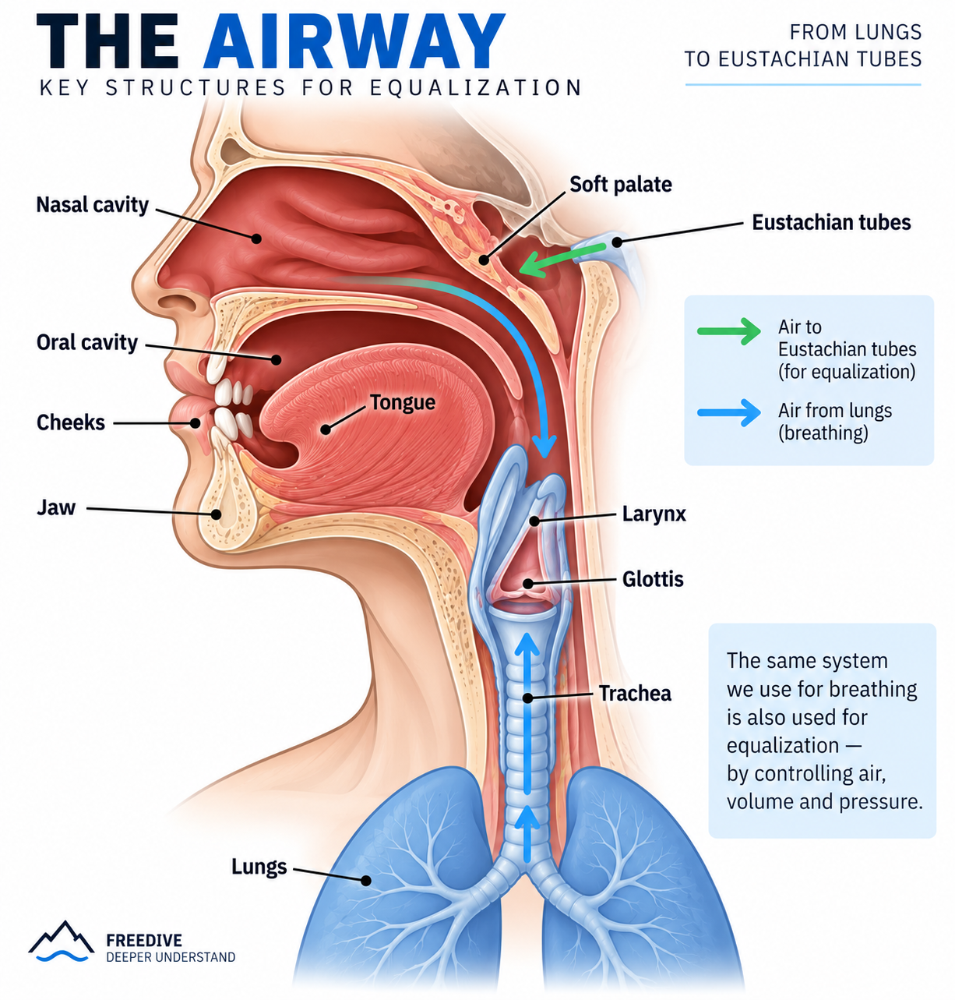
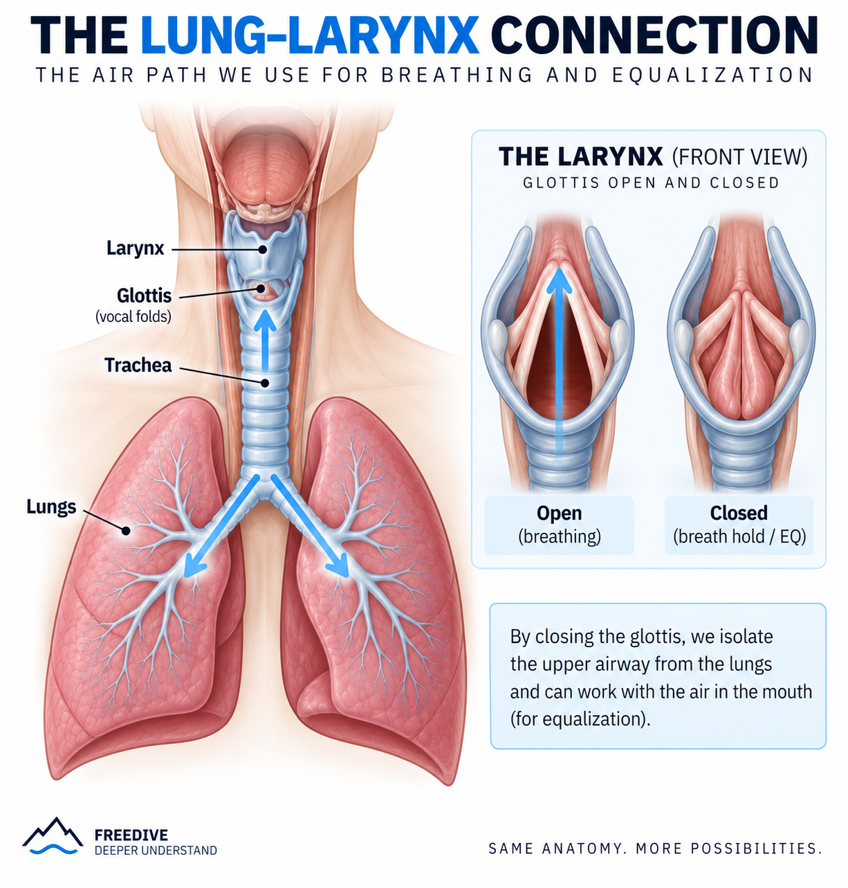
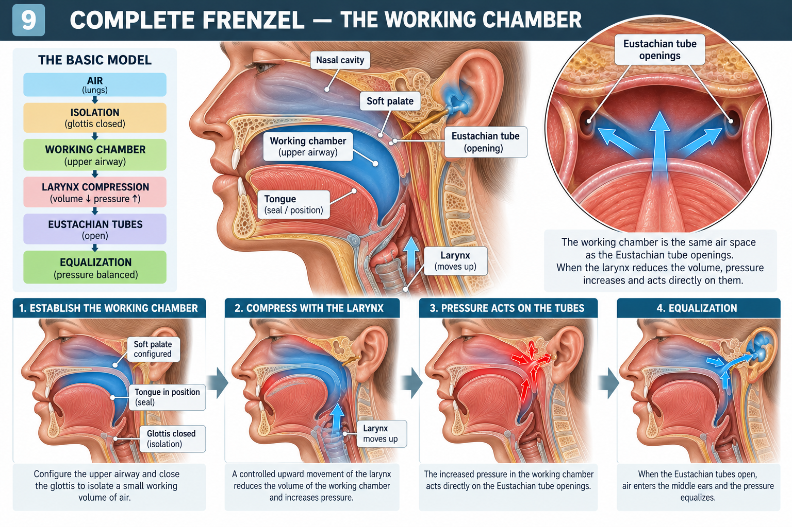

# PART 1 — THE AIR & THE EQ SYSTEM

**Duration:** ~45–50 min

## Methodology

Throughout Part 1, every exercise is performed and compared in **two body positions**:

- **NORMAL** — seated, upright position
- **INVERTED** — head down in an aerial yoga hammock

The objective is not to assume that inversion changes the result, but to **observe and compare what actually changes** in sensation, air movement and pressure.

**EXPLAIN → FEEL → SEE → MEASURE → INVERT → REPEAT → COMPARE**

- **Explain** — what the structure does
- **Feel** — perform the movement and identify the sensation
- **OtoVent** — observe physical / tactile feedback
- **UBA EQ Tool** — observe the pressure response
- **Invert** — repeat the same exercise head-down in the hammock
- **Repeat** — perform the same movement and protocol
- **Compare** — identify differences in sensation, air movement and pressure response

---

## 1. EQ IS NOT FORCE

**Duration:** 3 min

### Key concept

> Equalization is not about pushing harder.  
> It is about managing air, changing volume and creating pressure.

### Basic model

**AIR → VOLUME ↓ → PRESSURE ↑ → EUSTACHIAN TUBE → EQ**

### The main players

|  |  |
|-|-|

- **Lungs** — main air reservoir
- **Larynx** — volume / pressure control
- **Glottis** — gate
- **Tongue** — seal / lock
- **Oral cavity** — smaller, controllable air reservoir
- **Jaw + cheeks** — volume and air management
- **Soft palate** — pathway / direction

### OtoVent

Perform 1–2 simple attempts with minimal effort.

**Goal:**

> Do not look for maximum pressure.

### UBA EQ Tool

Perform 1–2 normal attempts.

Observe:

- pressure curve
- speed of pressure increase
- repeatability

**Do not use maximum pressure as the performance goal.**

---

## 2. REAL LIFE → EQ

**Duration:** 4 min

Connect familiar actions with the structures used in equalization.

| Everyday action | Main structures involved |
|---|---|
| **Yawning** | Jaw + soft palate |
| **Puffing the cheeks** | Cheeks + tongue + glottis |
| **Whistling** | Lips + tongue + cheeks |
| **Swallowing** | Tongue + soft palate + larynx / glottis |
| **Gulping** | Tongue + soft palate + larynx |
| **Cheek-to-cheek air movement** | Cheeks + tongue |
| **Sucking through a straw** | Lips + tongue + cheeks |
| **Drinking through a straw** | Lips + tongue + cheeks |
| **Blowing through a straw** | Lips + cheeks + tongue + glottis |
| **Inflating a balloon** | Cheeks + lips + tongue + glottis |
| **Holding air in the cheeks** | Cheeks + tongue + glottis |
| **Spitting** | Tongue + cheeks + lips |
| **Rinsing the mouth** | Cheeks + tongue + jaw |
| **Gargling** | Soft palate + tongue + glottis |
| **Sniffing** | Nasal cavity + soft palate |
| **Blowing the nose** | Soft palate + oral pressure + glottis |
| **Clearing the ears** | Jaw + tongue + soft palate |
| **Making a tongue click** | Tongue + oral pressure |
| **Saying “K”** | Tongue + soft palate |
| **Saying “T”** | Tongue + palate |
| **Saying “M”** | Lips + soft palate |
| **Saying “A”** | Jaw + tongue + soft palate |
| **Coughing** | Glottis + pressure |
| **Sneezing** | Soft palate + glottis + pressure |
| **Chewing** | Jaw + tongue + cheeks |
| **Holding water in the mouth** | Tongue + cheeks + lips |
| **Sucking a candy** | Tongue + cheeks + swallowing mechanism |
| **Moving food around the mouth** | Tongue + cheeks + jaw |

Where appropriate, demonstrate each movement with:

**EXPLAIN → OtoVent → UBA EQ Tool**

---

## 3. LARYNX — VOLUME & PRESSURE CONTROL

**Duration:** 6 min

### Larynx ≠ glottis

- **Larynx** = anatomical structure
- **Glottis** = opening / gate within the larynx

The movement of the larynx can change the configuration and volume of the air space.

### Exercise 1 — Larynx awareness

Practice:

- swallow and feel the larynx move
- imitate a swallow / "gulp"
- slowly move the larynx up and down
- hold different positions

### OtoVent

Repeat the slow larynx movements while observing the OtoVent response.

Focus on the physical sensation rather than producing maximum pressure.

### UBA EQ Tool

Repeat the same movements and observe:

- whether laryngeal movement produces a pressure response
- when the pressure response occurs
- whether the response is repeatable

### Exercise 2 — Larynx + closed airway

Hold the breath.

Practice controlled laryngeal movement without releasing air.

Focus on:

- keeping the airway closed
- moving the larynx independently
- feeling the change in the internal air space

### OtoVent

Repeat the exercise while observing the OtoVent response.

Focus on whether laryngeal movement produces a change in pressure.

### UBA EQ Tool

Repeat the exercise and observe:

**laryngeal movement → pressure response**

Do not increase effort to obtain a larger pressure peak.

---

### Goal

Feel:

**movement → volume change → pressure response**

The goal is **not** to perform an equalization.

The goal is to learn:

> I can change an internal air volume without simply releasing the air.

---

## 4. GLOTTIS — THE GATE

**Duration:** 4 min

The glottis controls the connection between the lungs and the upper airway.

### Basic states

**OPEN**

→ air can move

**CLOSED**

→ air is isolated

### Everyday examples

- breathing → open
- swallowing → closes
- coughing → forceful closure
- breath hold → closed

### Exercise

Practice - Glottis awareness:

**Breathe → Hold → Gentle release → Hold**

Focus on feeling the difference between:

- laryngeal movement
- glottis opening / closing

### OtoVent

Create a small amount of pressure.

Experiment with the airway open vs. closed.

### UBA EQ Tool

Compare:

**open airway**

vs.

**closed airway**

### Key takeaway

For techniques where we need to work with a limited air volume:

> **The glottis must isolate the upper airway from the lungs.**

---

## 5. JAW — CHANGE THE VOLUME

**Duration:** 4 min

The jaw changes the available space inside the oral cavity.

**Jaw ↓ → volume ↑**

**Jaw ↑ → volume ↓**

### Exercise

Slowly perform:

**OPEN → CLOSE → OPEN → CLOSE**

Then imitate a relaxed yawn.

### OtoVent

With air in the mouth:

**jaw open → jaw close**

Observe the feedback.

### UBA EQ Tool

Repeat:

**open → close → open → close**

Observe the jaw changes the volume of the oral space; the resulting pressure depends on the rest of the system.

### Key takeaway

> Pressure can be created without performing a Frenzel.

---

## 6. CHEEKS — RESERVOIR + COMPRESSION

**Duration:** 4 min

The cheeks can:

1. store air
2. move air
3. reduce the volume of the air space

### OtoVent exercises

1. Inflate both cheeks.
2. Hold the air.
3. Isolate one cheek.
4. Move air:
   - left → right
   - right → left
5. Slowly compress the cheeks.

### UBA EQ Tool

Practice:

**LOAD → HOLD → COMPRESS**

Observe the pressure curve.

### Key takeaway

> The cheeks can act both as an air reservoir and as a mechanism for reducing air volume.

This will become particularly important when introducing **Mouthfill**.

---

## 7. TONGUE — SEAL

**Duration:** 6 min

The tongue can create a seal and can also contribute to changing the volume of the isolated air space.

First introduce its ability to create a **seal / lock**.

### Exercise

Pronounce / feel:

**N → T → K**

Then:

**T → HOLD**

**K → HOLD**

Focus on:

- where the tongue contacts the palate
- how the contact creates a seal
- how the seal isolates a smaller amount of air

### OtoVent

Perform:

**T → compression → OtoVent**

Then:

**K → compression → OtoVent**

### UBA EQ Tool

Perform:

**T × 5**

**K × 5**

Observe:

- pressure peak
- curve shape
- repeatability

### Inverted

Repeat the same exercise **head-down in the aerial yoga hammock**.

Keep the tongue movement precise and relaxed.

Perform:

**N → T → K**

Then:

**T → HOLD**

**K → HOLD**

Focus on:

- Does the tongue contact with the palate feel different?
- Is the seal easier or harder to perceive?
- Does the isolated air volume feel different?
- Does the movement require more or less effort?

### OtoVent

Repeat:

**T → compression → OtoVent**

Then:

**K → compression → OtoVent**

Observe whether the physical feedback changes compared with the normal position.

### UBA EQ Tool

Repeat:

**T × 5**

**K × 5**

Compare the pressure response with the normal position.

Observe:

- pressure peak
- curve shape
- repeatability

### Compare

Compare **Normal vs. Inverted**:

- **Sensation** — does the tongue contact with the palate feel different?
- **Seal** — can you create the same clear seal?
- **OtoVent** — does the physical feedback change?
- **UBA EQ Tool** — does the pressure response or curve change?
- **Control** — can you reproduce the same movement with the same low effort?

> **The goal is not to produce maximum pressure. The goal is to observe whether body position changes the sensation and control of the tongue seal.**

### Key concept

> The tongue can isolate a small working air volume.

---

## 8. SOFT PALATE — AIRWAY ROUTING

**Duration:** 4 min

Creating pressure is only part of equalization.

The air also needs to be directed toward the nasal cavity.

### Exercise

Compare the sensations associated with:

**M**

vs.

**A / K**

Explore how changing the configuration of the vocal tract changes the available air pathway.

### OtoVent

Use the OtoVent to observe how different configurations affect air movement.

### UBA EQ Tool

Perform several configurations and observe the pressure response.

### Inverted

Repeat the same exercise **head-down in the aerial yoga hammock**.

Keep the same configurations and do not increase the effort.

Compare:

**M**

vs.

**A / K**

Focus on:

- Does the soft palate feel different?
- Does the available air pathway feel different?
- Is it easier or harder to perceive where the air is directed?
- Does the configuration require more or less effort to maintain?

### OtoVent

Repeat the same configurations with the OtoVent.

Observe whether the physical feedback changes compared with the normal position.

### UBA EQ Tool

Repeat the same configurations and compare the pressure response with the normal position.

Observe:

- pressure change
- timing of the response
- repeatability

### Compare

Compare **Normal vs. Inverted**:

- **Sensation** — does the soft palate configuration feel different?
- **Air pathway** — does the perceived direction of the air change?
- **OtoVent** — does the physical feedback change?
- **UBA EQ Tool** — does the pressure response or curve change?
- **Control** — can you reproduce the same configuration with the same low effort?

> **We are not looking for a predetermined result. We are observing whether body position changes the sensation and control of the upper airway.**

### Key takeaway

> It is not enough to create pressure.  
> We need to control where the air goes.

---

## 9. COMPLETE FRENZEL — THE WORKING CHAMBER

**Duration:** 12–15 min

### Goal

Bring the individual mechanisms together into one coordinated Frenzel technique.

The objective is to understand how the working air volume is isolated, compressed and used to equalize the ears.

### Basic model

| AIR  →  ISOLATION  →  WORKING CHAMBER  →  LARYNX COMPRESSION  →  EUSTACHIAN TUBES  →  EQUALIZATION |  |
|-|-|

### Step 1 — Establish the Working Chamber

The **working chamber is not a separate anatomical cavity**.

It is a small, functionally isolated volume of air created by the configuration of the upper airway and the tongue.

Review the roles of the main structures:

- **Glottis** — isolates the working air volume from the lungs.
- **Tongue** — creates a seal and reduces the volume of the isolated air space.
- **Soft palate** — helps control the configuration of the upper airway.
- **Nasal cavity** — contains the openings of the Eustachian tubes.

### Step 2 — Perform the Complete Frenzel

The instructor demonstrates the complete sequence slowly.

Participants practise:

1. Establish the intended upper-airway configuration.
2. Isolate the working air volume from the lungs.
3. Use a controlled tongue movement to reduce the working volume and increase pressure.
4. Observe whether the attempt produces the intended equalization response.
5. Relax and reset before repeating.

Keep the movement controlled and low-effort. Do not push from the chest or abdomen to obtain a larger pressure response.

### OtoVent

Where appropriate, perform a small number of gentle attempts with the OtoVent.

Observe the available tactile or airflow feedback.

### UBA EQ Tool

Perform a small number of attempts and observe:

- pressure response;
- curve shape and timing;
- repeatability;
- effort required.

Do not use maximum pressure as the performance goal.

### Step 3 — Observe and Verify

Distinguish between the following observations:

- **Pressure generated** — the device registers a pressure response.
- **Technique coordinated** — the participant can reproduce the intended movement with similar, low effort.
- **Equalization perceived** — the participant reports an ear sensation consistent with equalization.

These observations are not interchangeable. A pressure reading from the UBA EQ Tool or feedback from the OtoVent does not, by itself, confirm that the middle ears have equalized.

### Compare — Normal vs. Inverted

If safe and comfortable, repeat the same gentle exercise in the normal seated position and head-down in the aerial yoga hammock.

Compare:

- ability to maintain the working chamber;
- tongue coordination;
- pressure response;
- repeatability and effort.

The objective is to observe differences, not to assume that inversion improves the technique.

### Key takeaway

> The working chamber provides the isolated air volume used in Frenzel. Controlled tongue movement reduces that volume and increases pressure. Successful equalization must be assessed separately from the pressure reading.

### Transition to Part 2

Part 1 has introduced the components and brought them together in a basic dry Frenzel attempt.

Part 2 develops the technique further through T-Lock, T/Ca/H, Frenzel and Advanced Frenzel, before progressing to Mouthfill and Sequential Frenzel.

---

## END OF PART 1

### The six functions

At the end of Part 1, the students should be able to distinguish six different jobs:

| Function | Main structures |
|---|---|
| **Store air** | Lungs, cheeks |
| **Isolate air** | Glottis, tongue |
| **Change volume** | Larynx, jaw, cheeks, tongue |
| **Move air** | Larynx, tongue, jaw, cheeks |
| **Create a seal** | Tongue, lips, soft palate |
| **Direct air** | Soft palate + tongue |

---

### Final model

**1. AIR SUPPLY**  
Lungs provide the air.

↓

**2. ISOLATION**  
The glottis closes to isolate the working air volume from the lungs.

↓

**3. WORKING CHAMBER**  
The upper-airway configuration, including the tongue and soft palate, establishes the working air space.

↓

**4. LARYNGEAL COMPRESSION**  
Controlled upward movement of the larynx reduces the working volume and increases pressure.

↓

**5. PRESSURE AT THE EUSTACHIAN TUBE OPENINGS**  
The increased pressure acts on the openings of the Eustachian tubes.

↓

**6. EQUALIZATION**  
When the tubes open, air can enter the middle ears and help equalize pressure.

**Key principle:**

The glottis isolates. The tongue helps seal. The larynx changes the working volume. Pressure response and successful ear equalization are not the same thing.

---

## TRANSITION TO PART 2

### PART 1 — DRY EQ

> **How does the EQ system work?**

Part 1 introduced the structures and mechanisms involved in equalization and brought them together in a complete dry Frenzel attempt.

### PART 2 — IN-WATER EQ: 0–10 M

> **How do we apply equalization in the water?**

Part 2 focuses entirely on in-water equalization, progressing from **0 to 10 metres**.

The focus is on applying the technique underwater, observing the equalization response, and developing control throughout the descent.